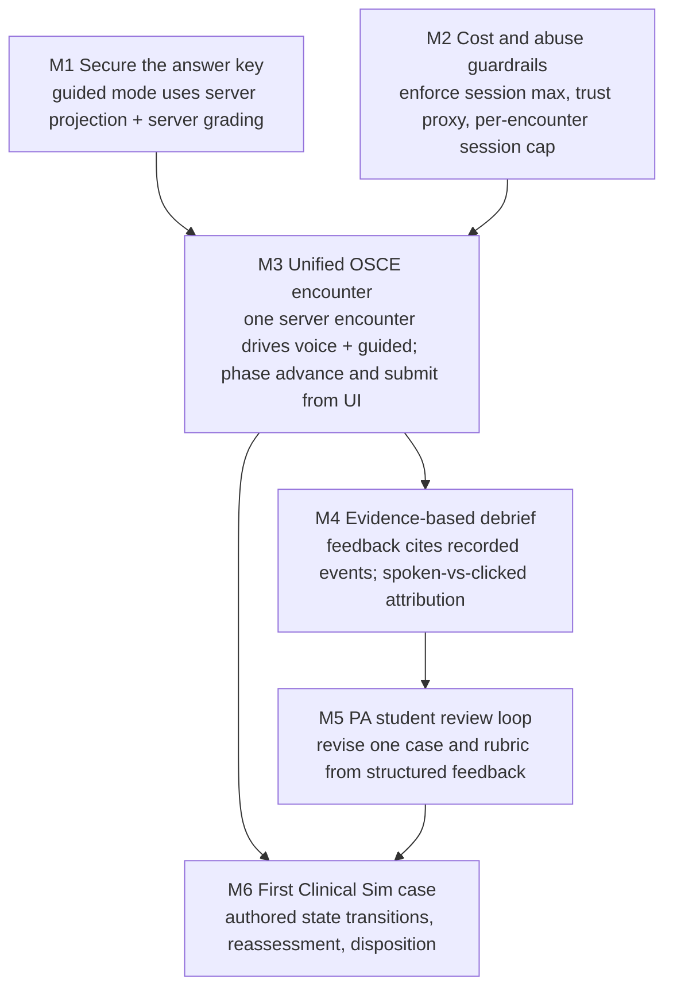

# ClinicSim product baseline

Verified against `main` at `a91a293` plus the uncommitted home screen
(`src/App.tsx`, `src/index.css`). Date: 2026-10-09.

Quality gates at baseline:

| Command             | Result                                                         |
| ------------------- | -------------------------------------------------------------- |
| `npm run typecheck` | Pass                                                           |
| `npm run lint`      | Pass, one warning: `react(set-state-in-effect)` in `Dashboard` |
| `npm test`          | 46 passed, 1 skipped (the billable live smoke test)            |
| `npm run build`     | Pass                                                           |

`npm run test:live` was not run; it is billable.

## 1. Verified current capabilities

"Verified" means read in code and covered by a passing test or a built
artifact. No live voice session was run for this baseline.

### Guided mode (browser only, no key)

- Five authored primary-care scenarios in `src/data/scenarios.ts`, validated by
  the Zod schema in `src/domain/schema.ts` on every provider read.
- Five fixed phases: history → exam → diagnostics → diagnosis → treatment.
  Each phase is locked after the student confirms advancing.
- Action visibility uses `rule.requires` / `rule.excludes` from scenario data.
  `unlocks` and `hides` are in the type but nothing reads them.
- `gradeAttempt` in `src/domain/grading.ts` is pure and deterministic:
  - weights: history 20, exam 15, diagnostics 15, diagnosis 20, treatment 20,
    communication 10;
  - each category starts at 50 and is clamped to 0–100;
  - pass threshold is 70;
  - any critical rule caps the final score at 59 and fails the attempt.
- Attempts are stored in `localStorage` (`clinicsim-attempts-v1`). Malformed
  data is treated as empty history. _(Superseded: see the update note in
  section 2 and `docs/architecture.md`.)_
- Results screen: category bars, strengths, misses, unnecessary/unsafe
  choices, correct diagnosis with reasoning, ideal plan.

### Server (Express, `server/`)

_Snapshot at `a91a293`. The `/api/encounters` routes and in-memory store have
since been replaced by `/api/attempts` backed by Postgres; see
`docs/architecture.md`._

- `GET /api/health`, `GET /api/ai/status`, `GET /api/scenarios`
- `POST /api/encounters`, `GET /api/encounters/:id`, `DELETE /api/encounters/:id`
- `POST /api/encounters/:id/tools/:tool`
- `DELETE /api/encounters/:id/events/:eventId`
- `POST /api/encounters/:id/phases/:phase/advance`
- `POST /api/encounters/:id/submit`
- `POST /api/live/session`, `POST /api/live/tool`

Behaviour:

- Encounters live in an in-memory `Map`.
- Responses are built by allowlist in `server/encounters/projection.ts`.
- Tool arguments are IDs only, checked with Zod. Each tool is locked to its
  phase, and replaying an action is idempotent.
- Diagnosis and plan tools require `confirmed: true` before a selection is
  graded.
- Submission uses the same `gradeAttempt` as the browser.
- The environment is validated at startup. The API key is read only through
  `server/config/env.ts`.
- CORS is restricted to `CLIENT_ORIGIN`.
- Provider errors are reduced to coarse codes before reaching the browser.
- Live session creation is rate limited per IP.

### Voice (`src/voice/`, `src/features/encounter/VoicePanel.tsx`)

- The browser creates the WebRTC offer, with the `oai-events` data channel
  added before the offer. The server calls `openai.live.create` and returns
  only `{ sessionId, sdp }`.
- The UI shows "Live" only after `session.started`.
- States covered: microphone denied or unavailable, missing key, network
  failure, WebRTC failure, retry, mute (the session keeps billing), end
  session, close-acknowledgement timeout, and cleanup on unmount.
- Transcript deltas are reassembled per speaker; overlapping speech stays
  separate.
- Delegated function calls are relayed to `/api/live/tool`. `response.create`
  is sent only after every pending call has its output.
- The patient prompt contains only patient-knowable history. Exam findings,
  test results and the answer key are excluded (tested).

### Home and navigation

- `/` is the home screen. Start OSCE Practice links to `/cases`. Start
  Clinical Sim is shown as "Coming soon" and is not a link.
- `/dashboard`, `/cases`, `/encounter/:scenarioId` and `/results/:attemptId`
  all route correctly. Unknown paths redirect to `/`.

### Not present

- Clinical Sim mode.
- `voice-generated` cases.
- Oral defense.
- AI-written debrief.
- Accounts or authentication.
- Server-side persistence.
- Book codes.
- Transcript storage.

## 2. Top 10 risks, ranked by severity

> **Update, 2026-10-09 (server-owned persistence):**
>
> - **Risk 1 resolved.** The browser bundle contains no answer key. This is
>   checked on every build.
> - **Risk 7 resolved.** Attempts persist in Postgres.
> - **Risk 9 resolved.** The fake profile and demo history are removed.
> - **Risk 2 partly resolved.** Voice and guided input now share one attempt
>   and one graded log. Voice-only phase advance is still not possible.
> - **Risk 4 partly resolved.** Live sessions now require an owned attempt, but
>   the dev identity is self-asserted.
> - **Decision for M1:** option (a). Guided mode requires the backend.

| #   | Severity | Risk                                                                                                                                                                                                                                                                                                                                                                      | Evidence                                                                                                                                                                                                |
| --- | -------- | ------------------------------------------------------------------------------------------------------------------------------------------------------------------------------------------------------------------------------------------------------------------------------------------------------------------------------------------------------------------------- | ------------------------------------------------------------------------------------------------------------------------------------------------------------------------------------------------------- |
| 1   | Critical | **Answer key ships to the browser in guided mode.** Full scenarios, including `correctPrimary`, `criticalRules`, `effects`, `idealPlan` and `teachingPoints`, are in the production JS bundle. Any student can read the answers in dev tools.                                                                                                                             | `staticScenarioProvider` is used by `Dashboard`, `Cases`, `Encounter`, `Results` and `App` in `src/App.tsx`. Built `dist/assets/*.js` contains `correctPrimary` ×9, `criticalRules` ×7, `idealPlan` ×9. |
| 2   | Critical | **Voice encounters are never graded.** `VoicePanel` creates a server encounter but never advances or submits it. The server stays in `history`, so voice exam, test, diagnosis and plan tool calls are rejected as `wrong_phase`. The score shown comes only from guided clicks.                                                                                          | `VoicePanel.tsx` only calls `POST /api/encounters`. `executeTool` checks `contract.phase !== record.currentPhase`.                                                                                      |
| 3   | High     | **Billed sessions have no server-side time limit.** `MAX_LIVE_SESSION_MINUTES` is reported but never enforced. A forgotten tab, or a client that never sends `session.close`, keeps billing.                                                                                                                                                                              | `env.ts` and `publicCapabilities()` are the only uses. `liveEndedAt` and `liveDurationSeconds` are never written.                                                                                       |
| 4   | High     | **The cost endpoint is unauthenticated, and rate limiting can be bypassed or over-applied.** Anyone allowed by CORS (or using curl, which ignores CORS) can create an encounter and open billed sessions. `req.ip` without `trust proxy` behind Render probably puts all users in one bucket, or lets attackers rotate IPs. The bucket map is in memory and never pruned. | `server/api/live.ts` `enforceRateLimit`. No `app.set('trust proxy')`. No auth middleware.                                                                                                               |
| 5   | High     | **No clinical review.** All scenarios are `requires-clinician-review`, but the UI shows pass/fail and "Strong clinical work." Feedback reliability is unvalidated.                                                                                                                                                                                                        | `reviewStatus` literal in the schema, and results screen copy.                                                                                                                                          |
| 6   | Medium   | **The browser decides when a tool runs.** Tool calls pass through the browser, so a modified client can call `/api/live/tool` or `/api/encounters/:id/tools/*` directly with any valid ID. IDs are validated, but whether the student actually _asked_ is not.                                                                                                            | Documented. `server/api/live.ts` `/tool`.                                                                                                                                                               |
| 7   | Medium   | **Server state is lost on restart.** Encounters are in memory: a Render restart or deploy drops every active encounter, and with it any future voice grade. With multiple instances, requests reach the wrong one.                                                                                                                                                        | `server/encounters/store.ts`.                                                                                                                                                                           |
| 8   | Medium   | **Deployment config is not in the repo.** There is no `vercel.json` or `render.yaml`. `CLIENT_ORIGIN` must be a full URL; a bare hostname crashes startup (seen locally in this session). SPA deep-link rewrites on Vercel are unverified.                                                                                                                                | Repository listing. Startup error `CLIENT_ORIGIN: Invalid URL`.                                                                                                                                         |
| 9   | Medium   | **Placeholder data looks real.** A hard-coded "Alex Morgan, PA-S student" profile chip, seeded demo attempts on the dashboard, and a `\|\| 5` fallback for the case count break the AGENTS.md rule against inventing user identities or counts.                                                                                                                           | `src/App.tsx` `Header`, `seedAttempts`, `Cases`.                                                                                                                                                        |
| 10  | Low      | **Structural debt in a 970-line `App.tsx`.** All screens are in one file. The grading and schema files are minified one-liners, which are hard to review. The visibility-rule test re-implements the logic instead of calling it. `unlocks` and `hides` are dead fields. `Results` falls back to re-grading when `feedback` is missing.                                   | `src/App.tsx`, `src/domain/*.ts`, `grading.test.ts`.                                                                                                                                                    |

## 3. Next six milestones: dependency graph

- **M1 and M2 can run in parallel.**
- **M3 depends on both:**
  - without M1, the unified flow would still ship the answers;
  - without M2, every test session is an unbounded cost.
- **M6 depends on M3** for the server encounter model, and **on M5** so the
  rubric approach is validated before a second mode copies it.
- **Not on the critical path** until M5 is done: accounts, server persistence,
  recommendations, book deep links.
- **Decision needed before M1:** guided mode currently works with no network
  connection. Moving its grading to the server means it needs the backend.
  Options:
  - **(a)** accept that guided mode requires the backend;
  - **(b)** keep an offline build with the answers in it, used only as a
    clearly labelled practice mode;
  - **(c)** ship the answers encrypted per attempt.

## 4. Preserve constraints

Any change that breaks one of these is a regression, whatever else it adds.

### Deterministic grading engine

- `gradeAttempt(scenario, attempt)` stays pure: no I/O, no clock, no
  randomness, no model output as input.
- The same event log always gives the same `GradingResult`. Resubmitting is
  idempotent.
- A critical rule always sets `passed: false` and caps `finalScore` at 59.
  Both `rawScore` and `finalScore` stay on the result.
- Weights, the 50 starting point, 0–100 clamping and the 70 pass threshold
  change only through a reviewed, versioned edit, never at runtime.
- **There is one grading implementation.** The server imports
  `src/domain/grading.ts`; do not fork it.

### Guided fallback

- With no `OPENAI_API_KEY` the app installs, builds, tests and runs. Guided
  mode completes and grades an encounter.
- A voice failure (microphone denied, provider error, network loss) never
  blocks finishing the encounter in guided mode on the same screen.
- `POST /api/live/session` returns `503 missing_api_key` without a key. It must
  not pretend a session exists.
- Guided mode requires the backend and an identity, but never an OpenAI key or
  a microphone.
- `npm test` never contacts OpenAI.

### Secret isolation

- `OPENAI_API_KEY` is read only in `server/config/env.ts`. It is never
  `VITE_`-prefixed, logged, returned, or put in fixtures or docs.
- `/api/ai/status` returns capabilities only.
- `/api/live/session` returns only `{ sessionId, sdp }`.
- Provider errors reach the browser only as the coarse codes in
  `server/api/live.ts`. The SDP and instructions are never logged.
- Prompts are built server-side in `server/prompts/` and never sent to the
  browser.
- `STORE_TRANSCRIPTS` defaults to `false`. Never enable it silently.

### Stable IDs

- Every phase, action, diagnosis, plan option, omission and critical rule has
  a stable string ID. Grading and tools refer to IDs only.
- Tool arguments accept IDs only. Scores, findings and display text are always
  resolved server-side from the locked scenario.
- Renaming an ID in authored content is a breaking change for saved attempts.
  Attempts pin a content version (`<scenarioId>@<hash>`), so old attempts keep
  their IDs. New attempts get the new content.
- Stored results reference `GRADING_VERSION`. Change scoring behavior only
  with a version bump; the pinned snapshot test enforces this.

### Spoiler-safe projections

- Browser payloads are built by **allowlist** (`toPublicScenario`,
  `toPublicAttempt`, `toPublicDebrief`, `toAttemptSummary`), never by deleting sensitive fields.
- These stay withheld until submission: `correctPrimary`, `criticalRules`,
  `omissions`, `idealPlan`, `teachingPoints`, every `effects`,
  `unsafe`/`unsafeReason`, diagnosis `reasoning`, and every action `response`.
- An action's `response` is released only by executing that action, in the
  current phase.
- Diagnosis options are published without any marker of which one is correct.
- Scenario summaries (title, complaint) must not name the diagnosis.
- `server/attempts/projection.test.ts`, `server/api/attempts.test.ts` and
  `scripts/check-bundle.ts` must keep
  passing and must be extended whenever a field is added to `ScenarioDefinition`.
